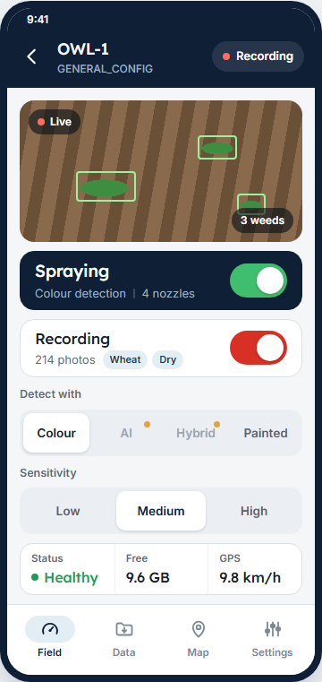
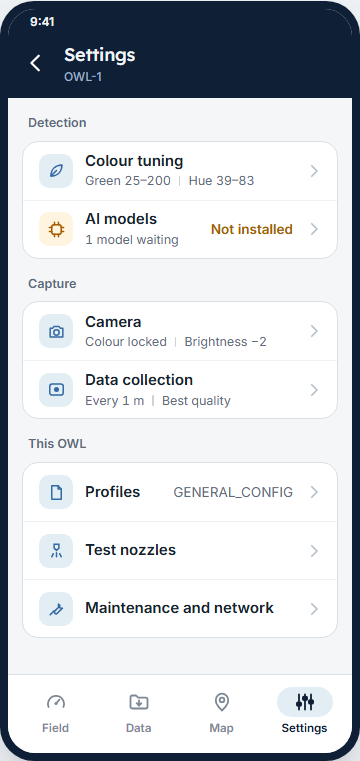
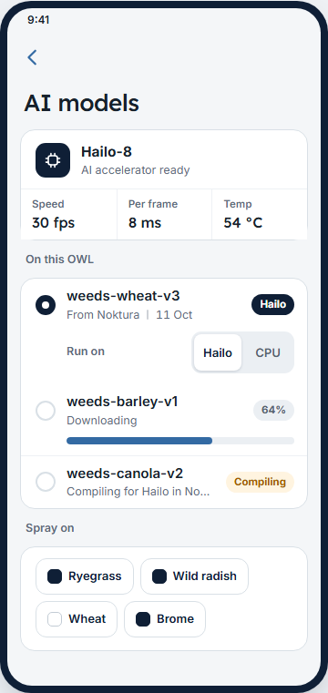
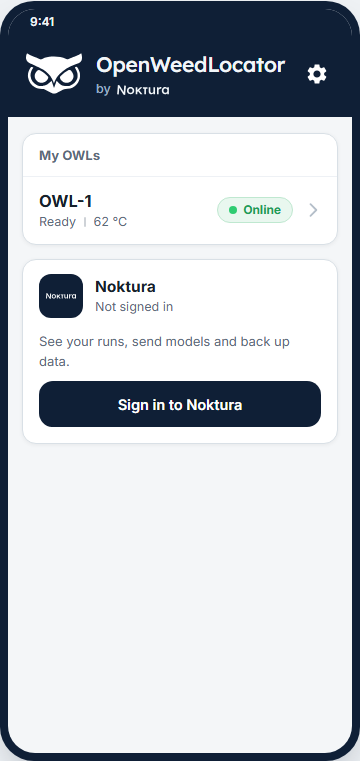
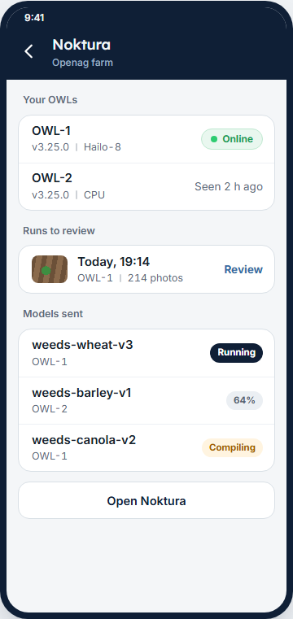
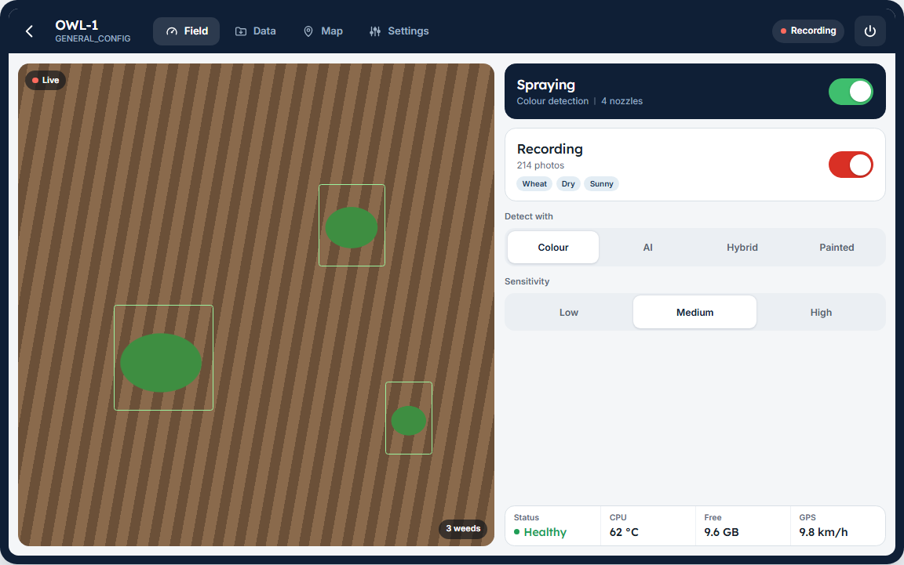

# OWL app

The OWL app is an Android app for setting up an OWL and controlling it from your phone. It works with standalone OWLs: the phone joins the OWL's Wi-Fi hotspot, so no router or internet is needed in the field.

## What the app does

- **First-time setup.** It finds a new OWL, checks the camera, and sets the Wi-Fi password and mode.
- **Control.** Turn spraying and recording on and off, choose the detection method, and set the sensitivity.
- **Record with details.** When you start recording, you tap the crop, weather, light and purpose. These are saved with every image and sent to Noktura with the run.
- **Data.** See each recorded session and download it to the phone.
- **Map.** See where the images were taken.
- **Settings.** Colour tuning, camera, white balance, data collection, profiles and maintenance.
- **Noktura.** Sign in to link your OWLs to your Noktura account.

## Getting the app

The app is in field testing and is not on the Play Store yet. Ask Noktura for the current `.apk` and install it on an Android phone running Android 10 or later.

## Coming next: the new design

The app is being redesigned along with the standalone and networked dashboards, so all three look and work the same way.

- **Field, Data, Map and Settings** are labelled tabs.
- **The camera comes first**, and spraying is one large switch.
- **Settings** is a short list with a page for each topic.
- **AI models** shows what runs the AI on this OWL (a Hailo-8 accelerator or the Pi's own processor), every model on the unit, and where each one runs.
- **Noktura** gets a card on the home screen that shows your linked OWLs and the runs waiting for review.
- **Tablets.** On a tablet, or a phone turned sideways, the app switches to a two-column layout.

::::{grid} 1 2 3 3
:gutter: 2

:::{grid-item}

:::

:::{grid-item}

:::

:::{grid-item}

:::

:::{grid-item}

:::

:::{grid-item}

:::
::::

<a href="../../_static/demos/redesign/index.html" target="_blank" rel="noopener">Open the full design preview</a>. It shows every screen, and the buttons respond to clicks. The design may still change before release.
