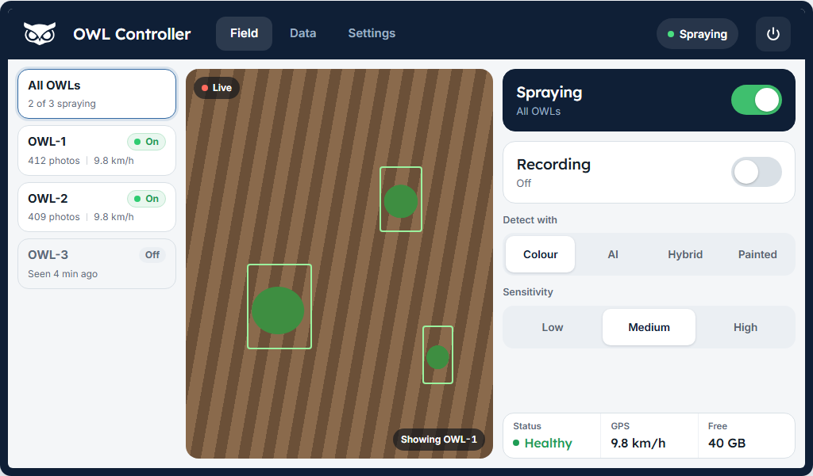
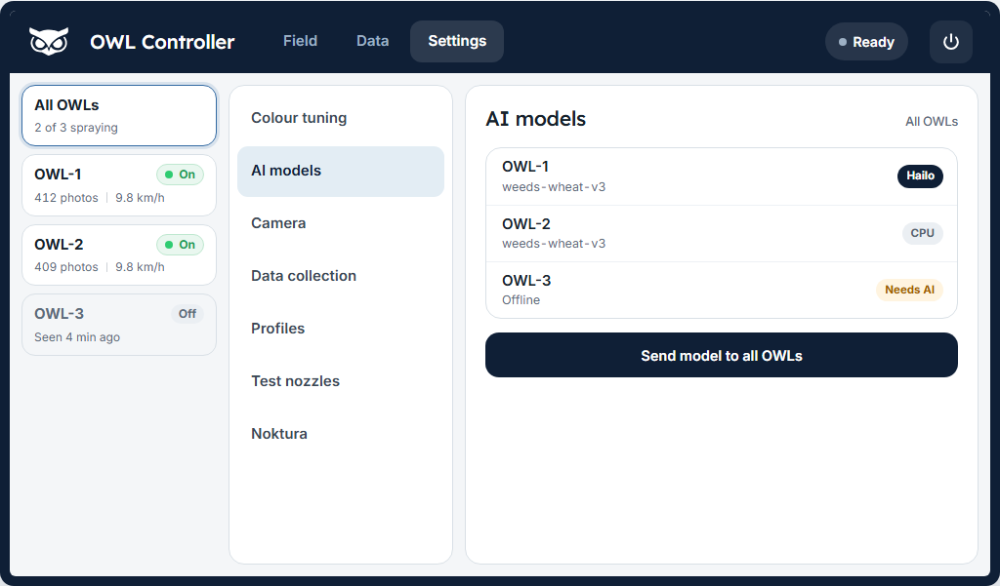

# Networked Setup

This guide walks you through connecting multiple OWL units to a shared WiFi network so they can all be monitored and controlled from a single dashboard. By the end, you'll have a working system where every OWL reports back to one central screen in the tractor cab.

## Example networked controller interface

This is a live, fully interactive mock of the dashboard running on sample data — click around, switch tabs, drag the sliders. On the **CONFIG** tab try **Test on OWLs** and **Save…**, and open **Adjust geometry** to drag the crop edges and actuation band over the (mock) camera feed.

```{raw} html
<div class="owl-demo-shell owl-demo-tablet">
  <iframe src="../../_static/demos/networked/index.html"
          loading="lazy"
          title="Networked controller interface"></iframe>
</div>
```

## Using the dashboard

The controller uses the same design as the standalone dashboard and the OWL app, with your OWLs listed down the left. The top bar has four pages, **Field**, **Data**, **Map** and **Settings**, a state pill and the power button.





**The OWL rail.** **All OWLs** is selected when the screen opens, and every control then acts on every OWL. Below it is one card per OWL with its state (On, Rec, Ready, Fault or Off), photos this run and speed. An OWL that drops out keeps its card, greyed, with **Seen x min ago**. Tap an OWL to see its camera and control it on its own; tap **All OWLs** to go back.

**Field.** The live view shows the selected OWL (or the first one online), with buttons to grab a frame and open the full video. On the right:

- **Spraying**: the big switch for the selected OWL or all of them.
- **Recording**: one run on all OWLs. It opens **What are you recording?**, the same form as the Collect screen, and starts every OWL with the same run id. While recording it shows the photo count and the chosen labels.
- **Detect with** and **Sensitivity**: as on the standalone. AI and Hybrid carry an amber dot when an OWL in the selection can't run AI, and tapping one explains why.
- **Stat cells**: status, GPS speed and free storage for All OWLs; status, CPU temperature, frame rate and free storage for one OWL.

Faults, speed warnings, a refused recording, a cab switch on an OWL or a needed restart show as notices above **Detect with**.

**Data.** The recordings on each OWL (or the selected one) with **Upload to Noktura** and delete. **Copy to a laptop** opens the downloads page described below.

**Map.** The GPS map with the track, compass, speed, satellites, distance, time and area.

**Settings.** A side list next to the rail:

| Page | What it holds |
|------|---------------|
| Colour tuning | A live snapshot, **Crop and spray zone**, the colour sliders and painted profiles, **Apply to OWLs** and **Save as profile** |
| AI models | All OWLs: one row per OWL with its model and where its AI runs (Hailo, CPU or Needs AI), **Send model to all OWLs** (the model library page) and **Install AI** for OWLs without it. One OWL: its models, classes to spray, tracking, AI confidence and crop buffer |
| Camera | White balance, calibration, brightness, size and rotation for all OWLs (same as the Collect screen) |
| Data collection | The capture settings of the Collect screen |
| Profiles | Saved profiles: load on the OWLs, use on startup, delete, save as new |
| Spraying | Speed-adaptive timing: speed, frame rate and spray-time gauges, spray length, crop buffer and AI confidence, and the computed spray time and delay |
| Test nozzles | **Hold to spray** (stops after 10 s) and **Blanket spray** |
| Noktura | The cloud link status and how to connect |
| Maintenance | Each OWL's version, temperature and load with **Restart**, **Update OWLs**, fix screen, restart controller and the model library |
| Advanced | The per-OWL INI editor and the AI assistant |

The **power button** turns off every OWL and the controller after a confirmation with a 3 second countdown. Wait 30 seconds after the screen goes dark before you switch off the power.

## Overview

A networked OWL connects to your existing WiFi and communicates with other devices using a lightweight messaging system called MQTT. This enables:

- Multiple OWLs on the same network
- Central monitoring from a touchscreen in the cab
- Integration with existing farm networks
- Remote start, stop, and configuration changes

```{admonition} Networked vs Standalone
:class: note

**Standalone OWL** creates its own WiFi hotspot — you connect directly to the OWL. Best for a single unit.

**Networked OWL** joins your existing WiFi — the OWL connects to your network. Best for multiple units managed together.
```

**Option A: Networked OWLs only** — Multiple OWLs connect to the same WiFi and a shared message broker. You monitor each OWL individually from any device on the network. Use this if you already have an MQTT broker or want to integrate with other systems.

```{mermaid}
graph LR
    subgraph "Your Network"
        R[WiFi Router]
        M[MQTT Broker<br/>Any device or cloud]
    end

    subgraph "OWL Units"
        O1[OWL-1]
        O2[OWL-2]
    end

    subgraph "Monitoring"
        L[Laptop]
        P[Phone]
    end

    R --- O1
    R --- O2
    R --- M
    R --- L
    R --- P
    O1 -.->|MQTT| M
    O2 -.->|MQTT| M
```

**Option B: Networked OWLs + Central Controller (recommended)** — A dedicated Raspberry Pi in the cab acts as the central hub with a touchscreen dashboard. It runs the message broker and shows all OWLs on one screen. This is the setup most farmers will want.

```{mermaid}
graph TB
    subgraph "Tractor Cab"
        C[Controller Pi<br/>with Touchscreen]
    end

    subgraph "Spray Boom"
        O1[OWL-1]
        O2[OWL-2]
        O3[OWL-3]
    end

    subgraph "Network"
        R[WiFi Router]
    end

    C <-->|WiFi| R
    O1 <-->|WiFi| R
    O2 <-->|WiFi| R
    O3 <-->|WiFi| R

    style C fill:#4CAF50,color:#fff
```

## Recommended hardware

For multi-OWL boom systems, the following parts are the proven combination. The first three (router, antenna, screen)
are the minimum kit for a working networked setup; PUR cable becomes relevant once you decide to add wired Ethernet.

- **Router** — [Teltonika RUT956](https://www.teltonika-networks.com/products/routers/rut956). Cellular failover plus
  built-in GPS, so remote access and GPS-driven actuation are covered by the same unit.
- **Outdoor antenna** — [QuWireless QuSpot for RUT955/956](https://www.quwireless.com/product/quspot-for-rut955-rut956).
  IP-rated, designed to mount on the tractor cab or boom with the cable run into the cab.
- **In-cab touchscreen** — [Edatec ED-HMI3010-101C](https://www.digikey.dk/da/products/detail/edatec/ED-HMI3010-101C-0432/22032904).
  10.1" 1280x800 touchscreen, native resolution matches the dashboard's kiosk default.
- **PUR-jacketed network cable** — CAT 6 S/FTP with PUR jacket. The PUR jacket holds up to UV, oil, and agricultural
  chemicals on the boom; standard PVC patch cable does not.

```{admonition} Ethernet is optional
:class: note

Ethernet to each OWL is the most reliable option but adds cost — a cable gland or weatherproof RJ45 connector per OWL,
plus the cable run from the cab. For smaller systems, a pure WiFi setup (router + antenna + screen, no per-OWL cabling)
is usually fine when there is line-of-sight from the antenna to each OWL. You can start with WiFi and add Ethernet
later if reliability becomes an issue.
```

```{admonition} Haven't run the installer yet?
:class: tip

Complete the [Two-Step Install](../../software/two-step-install.md) first, then return here when prompted for dashboard setup.
```

This guide follows **Option B** (controller + OWLs). If you're using Option A, skip to [Step 2](#step-2-set-up-each-owl) and point your OWLs at your existing MQTT broker instead.

---

## Networking terms used during setup

**WiFi network name (SSID)**
: The name of your WiFi. Both the OWLs and the controller need to join the same network.

**Password**
: Your WiFi password — the same one you use on your phone or laptop.

**IP address**
: Like a street address for each device on your network. Every device gets a unique one, such as `192.168.1.11`. Devices use these addresses to find and talk to each other.

**Static IP**
: An address that's permanently assigned to a device so it never changes. Without this, your router might give a device a different address each time it restarts, and the other devices won't be able to find it.

**Gateway**
: Your router's own IP address — the "front gate" that all network traffic goes through. It usually ends in `.1` (for example, `192.168.1.1`).

**Subnet**
: A group of addresses that can talk to each other directly. If your router is `192.168.1.1`, then all your devices should use addresses that start with `192.168.1.` — the last number is the only part that changes.

**MQTT**
: A lightweight messaging system that lets the OWLs talk to the controller. Think of the controller as a noticeboard — OWLs pin their status messages to it, and the dashboard reads them.

**MQTT broker**
: The device that runs the noticeboard. In a typical setup, the controller Pi runs the broker so you don't need any extra hardware.

```{tip}
**Where do I find my router's IP address?** Check your phone's WiFi settings (tap the network name for details), or look at the sticker on the bottom of your router. It's usually `192.168.1.1` or `192.168.0.1`.
```

---

## Planning your setup

Before powering on any Raspberry Pi, gather the following information and write it down on a piece of paper.

**What you'll need:**

- [ ] Your WiFi network name and password
- [ ] A Raspberry Pi for the controller (Pi 4 or 5, 4GB+ RAM recommended)
- [ ] Optional: a touchscreen display (EDATEC HMI3010 at 1280x800 or Raspberry Pi 7" display)
- [ ] One Raspberry Pi per OWL unit (with camera and relay board)
- [ ] A plan for IP addresses (see the table below)

**Recommended IP addresses:**

| Device | Address | Note |
|--------|---------|------|
| Router (gateway) | 192.168.1.1 | Usually already set — check your router |
| Controller | 192.168.1.2 | The in-cab Pi that runs the dashboard |
| OWL 1 | 192.168.1.11 | First OWL on the boom |
| OWL 2 | 192.168.1.12 | Second OWL |
| OWL 3 | 192.168.1.13 | Third OWL |
| OWL 4 | 192.168.1.14 | Continue the pattern |

```{tip}
Write these addresses on a piece of paper and keep it with your equipment. You'll need them during setup and they're useful for troubleshooting later.
```

**Router tips:**

- Use the **2.4 GHz** WiFi band if your router supports both 2.4 and 5 GHz — it has better range across a spray boom
- If possible, set up **DHCP reservations** (or "address reservation") in your router for each device, so the addresses are locked in even if a device loses its static IP setting
- Position the router centrally for good coverage across the boom

---

## Step 1 — Set up the controller

The controller is the central hub that runs the dashboard and message broker. Set this up first so the OWLs have something to connect to.

### What you'll need

- Raspberry Pi 4 or 5 (4GB+ RAM)
- MicroSD card flashed with **Raspberry Pi OS (64-bit)**, username set to `owl`
- Optional: touchscreen display for in-cab use

```{tip}
Use the free [Raspberry Pi Imager](https://www.raspberrypi.com/software/) tool to flash the SD card. When it asks for a username, enter `owl`.
```

### Run the controller setup

Connect the controller Pi to a monitor and keyboard (or access it via SSH), then run:

```bash
git clone https://github.com/geezacoleman/OpenWeedLocator owl
cd owl
sudo bash controller/networked/in-cab_controller_setup.sh
```

```{warning}
The controller setup **must** be run with `sudo`. If you forget, you'll see:

    [ERROR] This script must be run with sudo privileges.
```

The script will ask you a series of questions. Enter the values you wrote down in the planning step.

```{code-block} text
:caption: Controller configuration prompts

[INFO] Controller Configuration
=======================================
Enter your WiFi network name (SSID): FarmNetwork
Enter WiFi password: ********
Re-enter WiFi password to confirm: ********
Enter controller static IP (default: 192.168.1.2): 192.168.1.2
Enter router/gateway IP (default: 192.168.1.1): 192.168.1.1
Enter hostname (default: owl-controller): owl-controller
Enable kiosk mode on boot? (y/n, default: y): y
```

```{note}
**Kiosk mode** means the dashboard opens automatically in full-screen when the Pi boots — you won't see a normal desktop. This is ideal for a touchscreen in the cab. Enter **n** if you want a normal desktop environment.
```

Next, choose which screen the controller opens:

```{code-block} text
:caption: Dashboard choice

[INFO] Select the dashboard this controller opens:
  1) Full control     (detection, spraying, config, AI — OWL default)
  2) Data collection  (one record button, images, map, upload; no spraying)

Select dashboard (1-2, default 1): 2
```

Pick **Data collection** for a rig that only records images (see [Data collection mode](#data-collection-mode) below). Detection stays off on every OWL in this mode. The choice is saved as `ui` in the `[WebDashboard]` section of `config/CONTROLLER.ini`, and both screens stay reachable at `/full` and `/collect`, so you can change your mind later without re-running setup. If you re-run setup on a controller that already has `ui = collect`, the prompt defaults to 2 (`default 2`), so pressing Enter keeps the data collection screen.

If you enable kiosk mode, the script will ask which display you're using:

```{code-block} text
:caption: Display selection (kiosk mode only)

[INFO] Select your display:
  1) EDATEC HMI3010 10.1"         (1280x800, landscape — OWL default)
  2) Raspberry Pi Touch Display 2  (720x1280 panel — rotates to 1280x720 landscape)
  3) Generic HDMI / other          (pick a resolution)
  4) EDATEC 7"                    (1024x600, landscape)

Select display (1-4, default 1): 2
```

**Raspberry Pi Touch Display 2.** This panel is 720x1280 (portrait) in hardware, so to run the dashboard in landscape it has to be rotated. If you pick it, the script asks for an orientation:

```{code-block} text
:caption: Orientation (Touch Display 2 only)

[INFO] Select display orientation (landscape strongly recommended):
  1) Landscape             (recommended)
  2) Landscape (inverted)  (use if it comes up upside down)
  3) Portrait              (native, tall)
  4) Portrait (inverted)

Select orientation (1-4, default 1): 1
```

```{important}
**Always choose Landscape** for the Touch Display 2. The dashboard is laid out for landscape (1280x720 or wider) and portrait cuts off panels.

Rotating this panel on Raspberry Pi OS is fiddly — **Bookworm and Trixie both use the labwc/Wayland compositor**, and the `config.txt` panel rotation only turns the *boot logo*: the desktop ignores it, so the kiosk stays portrait. The script handles it correctly for you by rotating the desktop with `wlr-randr --transform` from the labwc autostart, and — because wlroots on the Pi does not move the touch digitizer with the display — realigning touch with a libinput calibration matrix in a udev rule (`/etc/udev/rules.d/99-owl-touch-rotate.rules`). It also clears any rotation you saved earlier in the desktop **Screen Configuration** tool (a kanshi transform), which otherwise re-applies on login and rotates the picture without the touch — the "landscape screen but the touch is sideways" fault. Everything takes effect after the reboot at the end of setup. If it comes up upside down, re-run setup and pick the *inverted* landscape option.
```

The script will also ask about GPS. The controller supports four GPS sources — pick whichever matches your hardware. A valid fix enables speed-adaptive spray timing, breadcrumb track recording, and the live map on the GPS tab:

```{code-block} text
:caption: GPS configuration

[INFO] GPS Configuration
  Select a GPS source for the controller. This enables
  speed-adaptive actuation and track recording.

    1) None           — no GPS (default)
    2) USB serial     — a Ublox or similar USB dongle on /dev/ttyACM* or /dev/ttyUSB*
    3) Teltonika TCP  — NMEA forwarded by a router to port 8500
    4) gpsd           — read from the local gpsd daemon (localhost:2947)

Select GPS source (1-4, default 1): 2
[INFO] Detected serial device: /dev/ttyACM0
Serial device path (default: /dev/ttyACM0):
Serial baud rate (default: 9600):
Enter boom width in metres (default: 12.0): 12
```

Which one should I pick?

- **None** — good for bench testing or if you don't care about speed-adaptive timing or track maps.
- **USB serial** — the simplest option. Plug a Ublox USB dongle (e.g. UBX-G7020-KT) into the controller Pi. The setup script auto-probes `/dev/ttyACM0`, `/dev/ttyACM1`, `/dev/ttyUSB0`, `/dev/ttyUSB1` and offers the first one it finds. Ublox factory baud is 9600.
- **Teltonika TCP** — use this if a Teltonika RUTX14 (or similar router) is already handling the GPS hardware and pushing NMEA over the network. Configure the router to forward NMEA to `<controller-ip>:8500`.
- **gpsd** — use this if you want the Linux `gpsd` daemon to manage the device (useful when multiple apps on the same Pi need GPS, or when you need SBAS corrections). **The script only installs the `gpsd` apt packages if you pick this option** — the other three sources add zero system dependencies.

Finally, review the configuration summary and confirm:

```{code-block} text
:caption: Configuration summary

[INFO] Configuration Summary:
=======================================
WiFi SSID: FarmNetwork
WiFi Password: [HIDDEN]
Static IP: 192.168.1.2
Gateway: 192.168.1.1
Hostname: owl-controller
Kiosk Mode: y
Dashboard: Full control
Display: rpi_touch2 (1280x720, landscape)
GPS: USB serial (/dev/ttyACM0 @ 9600, boom 12.0m)

Access Information:
  Dashboard: https://owl-controller.local/ or https://192.168.1.2/
  MQTT Broker: 192.168.1.2:1883

Continue with these settings? (y/n): y
```

The installation will then run automatically. It takes around 10-15 minutes. Watch for `[OK]` messages — if everything passes, you'll see a summary like this:

```{code-block} text
:caption: Successful controller setup

[INFO] OWL Controller Setup Summary:
============================================
[OK] System Packages
[OK] Python Environment
[OK] AI Agent Dependencies
[OK] Noktura Cloud Helper
[OK] MQTT Broker Configuration
[OK] SSL Certificate
[OK] Nginx Configuration
[OK] Avahi (.local) Configuration
[OK] Firewall Configuration
[OK] Dashboard Service
[OK] CONTROLLER.ini
[OK] Service Management
[OK] Kiosk Mode Configuration
[OK] WiFi Configuration
[OK] Static IP Configuration

[COMPLETE] OWL Controller setup completed successfully!
```

<details>
<summary>What to expect during installation (click to expand)</summary>

The script installs and configures each component in order. You'll see output like this:

```text
[INFO] Updating system package list...
[OK] System update completed successfully.
[INFO] Installing required system packages...
[OK] Installing system packages completed successfully.
[INFO] Setting up Python virtual environment...
[OK] Creating virtual environment completed successfully.
[INFO] Installing Python dependencies...
[OK] Installing Python dependencies completed successfully.
[INFO] Setting hostname to owl-controller...
[OK] Hostname configuration completed successfully.
[INFO] Configuring MQTT broker...
[OK] MQTT broker configuration completed successfully.
[INFO] Generating SSL certificate...
[OK] SSL certificate generation completed successfully.
[INFO] Configuring Nginx web server...
[OK] Nginx configuration completed successfully.
[INFO] Configuring Avahi for .local domain...
[OK] Avahi service configuration completed successfully.
[INFO] Configuring UFW firewall...
[OK] Firewall configuration completed successfully.
[INFO] Creating systemd service for OWL Controller Dashboard...
[OK] Dashboard service configuration completed successfully.
[INFO] Setting up kiosk mode (labwc, Raspberry Pi way)...
[OK] Kiosk mode configuration completed successfully.
[INFO] Configuring WiFi connection: FarmNetwork...
[OK] WiFi configuration completed successfully.
[INFO] Starting and enabling services...
[OK] OWL Controller dashboard service started successfully
[OK] Starting services completed successfully.

[INFO] Performing final system validation...
[INFO] Testing MQTT broker...
[OK] Mosquitto service is running
[OK] Mosquitto is listening on port 1883
[INFO] Testing local MQTT connection...
[OK] Local MQTT connection successful (attempt 1)
[OK] MQTT configuration file is correct
[OK] MQTT broker core functionality verified
[INFO] Final MQTT connectivity validation...
[OK] MQTT broker ready for OWL communication
[INFO] Testing dashboard service...
[OK] Dashboard service is responding
[INFO] Testing network connectivity...
[OK] Connected to FarmNetwork
[OK] Static IP 192.168.1.2 configured
```

</details>

When prompted, reboot the controller:

```text
Reboot now? (y/n): y
```

After reboot, the controller is ready. If kiosk mode is enabled, the dashboard will open automatically in full-screen.

**What the controller provides:**

| Component | What it does |
|-----------|-------------|
| MQTT broker | Central message hub — all OWLs send their status here |
| Dashboard | Web interface showing all connected OWLs on one screen |
| Nginx + SSL | Secure web server that handles video streaming |
| Kiosk mode (optional) | Full-screen dashboard that starts automatically on boot |

```{tip}
**Dashboard access:** Open `https://192.168.1.2/` in any browser on the same network. Your browser will show a security warning — this is normal and safe to click through. The connection is encrypted, but the certificate is self-generated rather than from a public authority.
```

**Next step:** Now set up each OWL unit using the controller's IP address (`192.168.1.2`) when prompted.

---

(step-2-set-up-each-owl)=
## Step 2 — Set up each OWL

Each OWL unit on the boom needs to be set up individually. The process is the same for each one — just change the OWL ID number and IP address.

### Run the OWL installer

On each OWL Pi, clone the repository and run the installer:

```bash
git clone https://github.com/geezacoleman/OpenWeedLocator owl
cd owl
bash owl_setup.sh
```

If the Pi was used before as a phone-app OWL, the installer first asks:

```{code-block} text
[WARN] This OWL is armed for phone-app setup (/boot/firmware/owl-firstboot.flag).
       Left armed, it keeps detection off and brings its setup hotspot back on boot.
Disarm it and set up by hand? [Y/n]:
```

Press **Enter** to disarm it. A networked OWL must not stay armed. On a fresh SD card you won't see this question.

The installer handles everything: system updates, camera check, virtual environment, OpenCV, and dependencies. When it asks about the web dashboard, say **yes**:

```{code-block} text
[INFO] Dashboard setup available...
Do you want to add a web dashboard for remote control? (y/n): y
```

The installer then runs the network setup automatically — you do not need to run a separate script.

```{tip}
If you need to re-run just the network setup later (without reinstalling everything), use:

    sudo bash ~/owl/controller/shared/setup.sh
```

### Choose networked mode

Select **Networked** mode and choose your connection type:

```{code-block} text
[INFO] Select OWL Operation Mode:
  1) Standalone - Create WiFi hotspot with local MQTT broker and dashboard
  2) Networked  - Connect to existing WiFi network with remote MQTT broker

Select mode (1 or 2): 2
[INFO] Networked mode selected

[INFO] Select network connection type:
  1) WiFi     - Connect to an existing WiFi network
  2) Ethernet - Use a wired LAN connection (eth0)

Select connection type (1 or 2, default: 1): 1
```

```{note}
**WiFi vs Ethernet:** Most setups use WiFi. Choose Ethernet if you've run a network cable directly to the OWL — this skips the WiFi credentials and uses the wired connection instead.
```

### Enter network settings

Enter the details for this OWL. Use the IP addresses you planned earlier.

**WiFi connection:**

```{code-block} text
[INFO] Configuring WiFi Client (Networked Mode)
Enter WiFi network name (SSID) to join: FarmNetwork
Enter WiFi network password: ********
Re-enter WiFi password to confirm: ********
Enter OWL ID number (default: 1): 1
Enter static IP for this OWL (e.g., 192.168.1.11): 192.168.1.11
Enter gateway IP (default: 192.168.1.1): 192.168.1.1
Enter central controller IP (MQTT broker; default: 192.168.1.2): 192.168.1.2
```

**Ethernet connection:** Same prompts but without the WiFi name and password.

The script validates that all your addresses are on the same subnet:

```{code-block} text
[OK] Network OK: OWL 192.168.1.11, Gateway 192.168.1.1, Controller 192.168.1.2 (base 192.168.1.x).
```

If there's a mismatch (for example, the OWL is on `192.168.1.x` but the controller is on `10.0.0.x`), the script will warn you and ask you to re-enter the addresses.

Review the summary and confirm:

```{code-block} text
[INFO] Networked Configuration Summary:
  Mode: Networked
  Hostname: owl-1
  Connection: WiFi (FarmNetwork)
  Static IP: 192.168.1.11
  Gateway: 192.168.1.1
  Controller IP: 192.168.1.2
  MQTT Broker: 192.168.1.2:1883 (remote)
  Video Feed: https://owl-1.local/video_feed

Allow VNC remote desktop (port 5900) through the firewall? (y/n, default: n): n
Continue with these settings? (y/n): y
```

```{warning}
**If you're connected via SSH:** When the network settings are applied, your SSH connection will drop because the Pi is switching to its new IP address. Reconnect using the new static IP:

    ssh owl@192.168.1.11
```

<details>
<summary>What to expect during OWL setup (click to expand)</summary>

In networked mode, the OWL installs MQTT clients (not a broker) and configures networking:

```text
[INFO] Installing required system packages...
[INFO] Installing MQTT clients only (networked mode)...
[OK] Installing system packages completed successfully.
[INFO] Skipping MQTT broker setup (networked mode - using remote broker)
[INFO] Configuring WiFi client connection: FarmNetwork...
[OK] WiFi configuration completed successfully.
[INFO] Configuring firewall (UFW)...
[OK] UFW firewall configuration completed successfully.
[INFO] Setting hostname to owl-1...
[OK] Setting hostname completed successfully.
[INFO] Generating SSL certificates...
[OK] SSL certificate generation completed successfully.
[INFO] Setting up Nginx web server...
[OK] Nginx configuration completed successfully.
[INFO] Configuring Avahi for .local domain resolution...
[OK] Avahi service configuration completed successfully.
[INFO] Starting and enabling services...
[OK] Starting services completed successfully.
```

The setup writes configuration to `GENERAL_CONFIG.ini` and `CONTROLLER.ini` automatically — you don't need to edit any config files manually.

The script also installs the device-settings permissions (v3.11+): a root-owned
password helper (`/usr/local/sbin/owl-set-user-password`) and sudoers entries for
`nmcli` and `reboot`, which the phone app's device settings (network changes,
password changes, restart) rely on. v3.12 adds `date` and `timedatectl` to the
same sudoers alias so the app can correct the clock on RTC-less units
(`/api/time/sync`). v3.15 adds the software-update rule
(`/etc/sudoers.d/96-owl-update`, a transient `systemd-run` unit for
`owl_update.sh`) and `systemctl restart owl-dash.service`, which the phone
app's Maintenance card uses to update the OWL and bring the new dashboard
up. Re-running `controller/shared/setup.sh` on an
already-deployed OWL is the supported way to add these to older units — the
script is idempotent.

</details>

When prompted, reboot the OWL:

```text
Reboot now? (y/n): y
```

### Repeat for each OWL

For each additional OWL, repeat the process above with:
- An incremented **OWL ID** (1, 2, 3...)
- A unique **static IP** (192.168.1.11, .12, .13...)

Everything else (WiFi name, password, gateway, controller IP) stays the same.

---

## Step 3 — Verify everything works

### Check the controller

1. Open `https://192.168.1.2/` in a browser on the same network. You should see the OWL Controller dashboard.

2. Your browser will show a security warning — this is normal. Click "Advanced" and then "Proceed" (the exact wording varies by browser). The connection is encrypted and safe.

3. As each OWL comes online after reboot, it should appear as a card on the dashboard within a few seconds.

4. To check the message broker is running, open a terminal on the controller and run:

```bash
mosquitto_sub -h localhost -t "owl/#" -v
```

You should see messages from each connected OWL appearing every few seconds.

### Check each OWL

On each OWL, verify the connection:

```bash
# Check WiFi is connected (or Ethernet)
nmcli con show --active

# Check the correct IP address is assigned
ip addr show wlan0    # use eth0 for Ethernet

# Test that the OWL can reach the controller
mosquitto_pub -h 192.168.1.2 -t "owl/test" -m "hello from owl-1"

# Check the detection service is running
sudo systemctl status owl.service
```

If the MQTT test completes silently (no output), it worked. If you see `Error: The connection was refused`, check that the controller is powered on and connected to the same network.

```{note}
If OWLs don't appear on the dashboard, see the [Troubleshooting](#troubleshooting) section below.
```

### Check GPS (if enabled)

If you selected a GPS source during setup, open the **GPS** tab on the dashboard. You'll see:

- **A live map** filling the tab, centred on your current fix. When internet is available, the map loads OpenStreetMap tiles; when offline (common in the cab) it falls back to a dark grid so breadcrumbs still render. Use the **Centre** button to re-centre on the current fix and **Fit all** to zoom to the whole recorded track.
- **A breadcrumb trail** showing where you've been during the current session. Points are buffered in memory and polled every 5 seconds, so you'll see the track extend as you drive. The coloured dot is your current position: green = HDOP ≤ 1 (excellent), amber = HDOP ≤ 2 (good), red = HDOP > 2 (poor).
- **Compact dials** overlayed on the corners: compass with heading top-left, speed (km/h) top-right, and a stats strip at the bottom showing satellites/distance/time/area.
- **A status banner** along the top — `GPS Connected` (green), `Searching for Satellites…` (amber), or `GPS Disconnected` (grey).

If the banner stays grey, check:

```bash
# USB GPS: confirm the device is enumerating
ls /dev/ttyACM* /dev/ttyUSB*

# USB GPS: see raw NMEA lines (Ctrl+C to stop)
sudo cat /dev/ttyACM0

# gpsd: verify the daemon is running
sudo systemctl status gpsd
gpsmon

# Teltonika TCP: tail the controller log for connection attempts
journalctl -u owl-controller -f | grep -i gps
```

A cold Ublox fix typically takes ~30 seconds outdoors with a clear sky view; warm/hot starts are faster.

---

## Downloading recorded images

Each OWL saves images to its USB drive during detection. The networked controller lets you pull those images wirelessly — no need to walk out to each unit and unplug a USB drive.

Open the downloads page at `https://<controller-ip>/downloads` (this is a separate page from the main kiosk dashboard, designed for use on a laptop).

### How to download

1. **Select an OWL** from the dropdown — only online devices can be selected
2. **Scan sessions** — the controller asks the OWL to list its recording folders. This takes a couple of seconds
3. **Transfer** — pick a session and hit Transfer. The OWL packages the images into a ZIP and sends it to the controller over your WiFi network. A progress bar shows the transfer status
4. **Download to your laptop** — once transferred, the ZIP appears in the "Downloaded files" section. Click Download to save it to your computer

### Managing storage

Transferred ZIPs are stored on the controller in a `downloads/` directory with a 2 GB quota. The storage meter shows how much space is used. Remove old files to free space for new transfers.

You can also delete sessions directly from the OWL's USB drive using the "Delete from OWL" button. This is permanent — make sure you've transferred the data first.

---

## Data collection mode

Choose **Data collection** at setup (or set `ui = collect` under `[WebDashboard]` in `config/CONTROLLER.ini` and restart `owl-controller`) for a rig that records images for training data rather than spraying. The screen is built for gloved hands on a 7" EDATEC (1024x600) or the 10" HMI3010, with English and Danish (EN/DK in the top bar).

**Record tab.** One large button starts and stops recording on every OWL. Tapping it opens a short form with big buttons: crop (with winter or spring for wheat, barley, oilseed rape, rye and triticale), weather, light, purpose (herbicide, fungicide, insecticide or survey) and optional notes. These go into every image's EXIF and into `session_metadata.json` in each session folder. Beside the button, a row per OWL shows images saved, speed, shutter time and gain, and free storage, and below it the latest saved image from each OWL refreshes every couple of seconds.

**Quality warnings** appear in plain language, naming the OWL and what to do:

- *Blur risk*: ground movement during one exposure (GPS speed x shutter time) is over the limit, with the speed to slow to
- *Images softer than at the start*: sharpness has dropped below 60% of the first images (check the lens)
- *Too dark* or *Overexposed*
- *Not saving*: moving, but no new image for 10 s
- Offline OWL, low storage, no GPS fix, clock not set, no internet (when connected to Noktura)

**Live view.** Each OWL's row on the Record tab has a **Live view** button that opens its camera feed full screen, with buttons to switch between OWLs. **Close** stops the feed.

**Map tab.** Every image location from the current run, coloured per OWL, over map tiles (a plain grid when offline).

**Settings tab.**

- *Sessions and upload*: the sessions on each OWL with size; tick and tap **Upload selected** to send them to Noktura. Uploads use the router's mobile data, so nothing is ever uploaded automatically. **Delete selected** removes the ticked sessions from the OWLs after a confirmation, usually once they are uploaded. A session that is still recording, uploading or waiting for Noktura is never deleted.
- *Capture*: still images or video clips (up to 60 s), spacing by distance (every X m from GPS speed, every Y s without GPS, nothing while parked) or by time, JPEG quality, the blur limit, and **Limit shutter time for speed**, which shortens the shutter as you drive faster and raises the gain instead. It switches itself off whenever GPS speed is missing. Saved as `[Collect]` keys in `CONTROLLER.ini` and pushed to every OWL.
- *Camera* (all OWLs at once): resolution, brightness, white balance with **Calibrate white balance**, gain limit and rotation. Resolution and rotation restart the OWLs.
- *Noktura*: connection status and **Connect** (below).
- *Full dashboard*: opens the full controller screen (Field, Data, Map and Settings). Its top bar has a **Collect** button to come back.

```{note}
The shutter limit depends on how your camera driver handles a fixed shutter with automatic gain. Before relying on it, run `python tools/shutter_cap_probe.py` on one OWL (stop `owl.service` first) and check the result as described at the top of that script.
```

### Connecting the rig to Noktura

A rig connects to Noktura through the controller, with one cloud connection for the controller and every OWL. Each OWL also needs internet through your router, because uploads go straight from the OWL to storage.

1. In Noktura's fleet admin, create a site for the rig and register the controller (`owl-controller`, type fleet controller) and each OWL by its local id (for example `owl-1`).
2. Open the one-time credential link and copy the command shown.
3. On the controller: **Settings**, **Noktura**, paste the command and tap **Connect**. This is easiest from a laptop on the same network at `https://<controller-ip>/collect`.

The pill in the top bar then shows **Noktura connected**, and **Uploading n%** while an upload runs.

```{note}
**Mobile data.** From v3.21.0, the rig sends Noktura only a small status message:
- as soon as something Noktura uses changes,
- otherwise once every 20 seconds for each device.

GPS is not streamed. With two OWLs this is under 1 MB per running hour, before any upload.
Uploads use the size of the images you send.

Earlier releases sent each OWL's full status every 2 seconds, about 20 MB per running hour.
```

```{warning}
**Rig paired before v3.21.0?** Updating the software does not change the cloud connection. Over
SSH on the controller, run `sudo bash ~/owl/controller/setup/install_firstboot.sh --cloud-helper`.
Then tap **Connect** again with the same command. If you do not have the command any more,
reissue the credential in Noktura.
```

---

## Troubleshooting

### WiFi or network problems

```bash
# Check if WiFi is connected
nmcli con show --active

# See available WiFi networks
nmcli dev wifi list

# Check your IP address
ip addr show wlan0

# Manually reconnect to WiFi
sudo nmcli con up "FarmNetwork"

# Restart the network service
sudo systemctl restart NetworkManager
```

If the OWL has the wrong IP address, re-run the network setup:

```bash
sudo bash ~/owl/controller/shared/setup.sh
```

### OWLs not appearing on controller

First, check the MQTT broker on the controller:

```bash
# Is the broker running?
sudo systemctl status mosquitto

# Can the controller receive messages?
mosquitto_sub -h localhost -t "owl/#" -v
```

Then, from the OWL, check it can reach the controller:

```bash
# Can the OWL reach the controller?
ping 192.168.1.2

# Can the OWL send MQTT messages?
mosquitto_pub -h 192.168.1.2 -t "owl/test" -m "hello"
```

If `ping` works but MQTT fails, the firewall on the controller may be blocking port 1883:

```bash
# On the controller, check firewall rules
sudo ufw status
```

### Video feed not working

```bash
# Check nginx is running
sudo systemctl status nginx

# Test the video feed locally on the OWL
curl -k https://localhost/video_feed

# Check the camera is detected
vcgencmd get_camera    # Pi 4 and earlier
libcamera-hello --list-cameras    # Pi 5
```

### Services not starting

```bash
# Check the OWL detection service
sudo systemctl status owl.service
journalctl -u owl.service --no-pager -n 50

# Check the controller dashboard service
sudo systemctl status owl-controller
journalctl -u owl-controller --no-pager -n 50
```

For more help, see the [full Troubleshooting Guide](../../troubleshooting/index.md).

---

## Reference

### MQTT topics

Each OWL publishes to device-specific topics. Replace `{id}` with the device ID (e.g., `owl-1`).

| Topic | Purpose |
|-------|---------|
| `owl/{id}/state` | Full device state (detection mode, algorithm, settings) |
| `owl/{id}/commands` | Control commands sent to the OWL (start, stop, config changes) |
| `owl/{id}/status` | Heartbeat and connectivity status |
| `owl/{id}/config` | Configuration data |
| `owl/{id}/indicators` | Short events for the dashboard lights: weed detected, image written, drive full |
| `owl/{id}/errors` | Error log lines from the OWL (level, message, time) |
| `owl/{id}/gps` | GPS data from the controller (local only, not sent to Noktura) |
| `cloud_out/{id}/state` | Small status for Noktura (the fields the cloud uses), sent on change or every 20 s. The controller's cloud bridge forwards this instead of the full state. Local publish only |
| `owl/{id}/capture` | One event per saved image, for the data-collection map (local broker only) |
| `owl/{id}/thumb` | Latest saved image as a small JPEG, for the data-collection gallery (local broker only) |
| `owl/cloud/policy` | Retained upload-host policy the controller publishes for networked OWLs |
| `owl/cloud/{id}/commands` | Commands from Noktura for one OWL, delivered through the controller's cloud bridge. The OWL only acts on an allowlist (list, upload, preview and delete sessions, update to a release tag, download and select a model, restart, reboot); they never reach `owl/{id}/commands` |
| `owl/cloud/owl-controller/commands` | Noktura's replies to upload requests (`upload_request_ack`), delivered through the cloud bridge |

The controller also exposes these HTTP endpoints for the dashboard:

| Endpoint | Returns |
|----------|---------|
| `GET /api/gps` | Current fix, connection status (`gps_connected`, `source`), and session stats |
| `GET /api/gps/breadcrumbs` | Live in-memory track points (`coordinates: [[lon, lat], …]`, `recording: bool`) — used by the GPS tab map |
| `GET /api/gps/tracks` | List of saved GeoJSON track files |
| `GET /api/gps/tracks/<filename>` | Download a saved GeoJSON track |
| `POST /api/gps/config` | Update runtime values like `boom_width` |

To watch all messages from all OWLs:

```bash
mosquitto_sub -h 192.168.1.2 -t "owl/#" -v
```

### Tuning detection (Settings > Colour tuning)

**Settings > Colour tuning** tunes detection on the OWLs selected in the rail (all of them when **All OWLs** is selected). The model is: **make a change, see it take effect, then save it under a name you choose.**

- **Sliders apply live.** Dragging a threshold slider (green, hue, saturation, brightness, smallest weed) pushes the change to the selected OWLs immediately. Nothing is saved yet.
- **Apply to OWLs** also pushes any changes made in **Settings > Advanced** (the INI editor) live, without saving.
- **Save as profile** opens a dialog where you give the setup a **name** and optional **notes**, and tick **Make active on reboot**. The config is stored in the controller library and on each OWL's disk. A date is appended automatically so saves never overwrite each other. If a saved config is currently selected, the dialog also offers **Update "&lt;name&gt;"** to overwrite it in place instead of creating a new file.
- **Settings > Profiles** lists saved configs by name and date; selecting one shows its notes and save date beneath. **Load on OWLs** applies one live; **Use on startup** makes the selected config the one OWLs load on reboot. The running profile shows at the top of Profiles, with **OWLs differ** when the OWLs run different thresholds.

```{admonition} Mount geometry is separate
:class: note
Detection configs do **not** include the crop or actuation band: that is per-unit
mount geometry kept in each OWL's `GEOMETRY.ini`. Loading or saving a detection
config never changes a unit's geometry. Use **Crop and spray zone** (below) to change it.
```
- **Restart notice.** A few settings (camera `resolution`, `relay_num`) can't change live. If you edit one, a notice appears on Field and in Profiles with **Restart OWLs**.

#### Visual geometry editor

Tap **Crop and spray zone** in **Settings > Colour tuning** (or **Settings > Camera**) to drag the crop and actuation band directly on the live feed. The editor automatically switches that OWL's preview to the **full uncropped frame** while open (and back to the normal cropped view when you close), so the overlay always lines up — you don't need to touch detection.

- Drag the four **edge handles** to crop independently from the left, right, top and bottom — useful to exclude a boom, wheel track, or shaded edge. The **relay lane lines** redraw as you drag so you can see them recenter across the cropped width.
- Drag the two **band handles** to set the **actuation band** — a weed fires its relay only while its centre is inside the band. Raise the top to ignore weeds too far ahead; lower the bottom to ignore weeds too close.
- Use the **nudge buttons** for fine adjustment in a bumpy cab.
- **Done** saves the geometry to that OWL's `GEOMETRY.ini` (it persists across reboots). **Cancel** reverts to how it was when you opened the editor. Tick **Apply to all OWLs** before Done to write the same geometry to every connected unit (handy for an identically-mounted boom).

These same values can be set by hand in `GEOMETRY.ini` (`crop_left/right/top/bottom`, `actuation_top/bottom`) — see [Configuration](../../software/configuration/index.md) — so OWLs running without a controller get the feature too.

#### Two feeds side by side + zoom

With more than one OWL you can tune two at once. Use the **1 feed / 2 feeds** toggle, and pick which OWL shows in each slot. Both feeds show their own crop/band handles and are dragged independently — **each feed pushes to its own OWL**. Tap a feed to make it **active** (highlighted); the shared controls panel then acts on that one. **Apply to all OWLs** still copies the active feed's geometry to every unit.

Each feed has its own **zoom**: the `-` and `+` buttons (or scroll wheel / pinch) magnify the feed *and* its overlay together so you can place edges precisely on small weeds or rows; drag the feed to pan when zoomed in. Zoom is purely a closer look — the crop fractions don't change.

```{note}
The normal live feed always shows the **cropped** frame (what the detector sees), with detection on or off. Only the geometry editor temporarily shows the full frame.
```

### Configuration files

The setup script configures these files automatically — you should not need to edit them manually.

| File | Location | Purpose |
|------|----------|---------|
| `GENERAL_CONFIG.ini` | `~/owl/config/` | Detection parameters, sensitivity presets, relay mapping |
| `CONTROLLER.ini` | `~/owl/config/` | MQTT settings, network mode, GPS, actuation timing |
| Network config summary | `/opt/owl-dash-config.txt` (OWL) or `/opt/owl-controller-config.txt` (controller) | Human-readable record of setup choices |

### System services

| Service | Runs on | Purpose |
|---------|---------|---------|
| `owl.service` | Each OWL | Weed detection and camera |
| `owl-controller` | Controller | Dashboard web application |
| `mosquitto` | Controller | MQTT message broker |
| `nginx` | Both | Web server (SSL, video proxy) |

Common service commands:

```bash
# Check if a service is running
sudo systemctl status owl.service

# Restart a service
sudo systemctl restart owl-controller

# View live logs
journalctl -u owl.service -f
```

### Scaling

| OWL count | WiFi recommendation |
|-----------|---------------------|
| 1-4 | Single router, 2.4 GHz band |
| 5-8 | Dual-band router or mesh network |
| 8+ | Multiple access points along the boom |

Each OWL video stream uses approximately 1-2 Mbps. MQTT overhead is minimal (around 10 Kbps per OWL).

---

## Next steps

```{seealso}
- [Standalone Setup](standalone.md) - Single OWL with WiFi hotspot
- [Configuration Guide](../../software/configuration/index.md) - Detection parameter tuning
- [Controllers](../../controllers/index.md) - Wired and wireless controller options
- [Use Cases](../../usage/use-cases/index.md) - Application examples and field deployment
```
