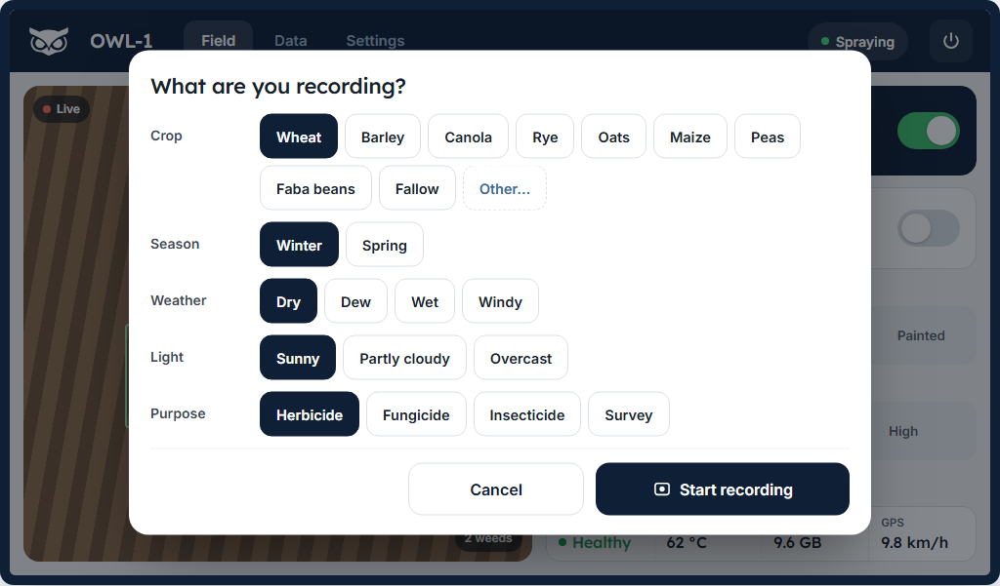
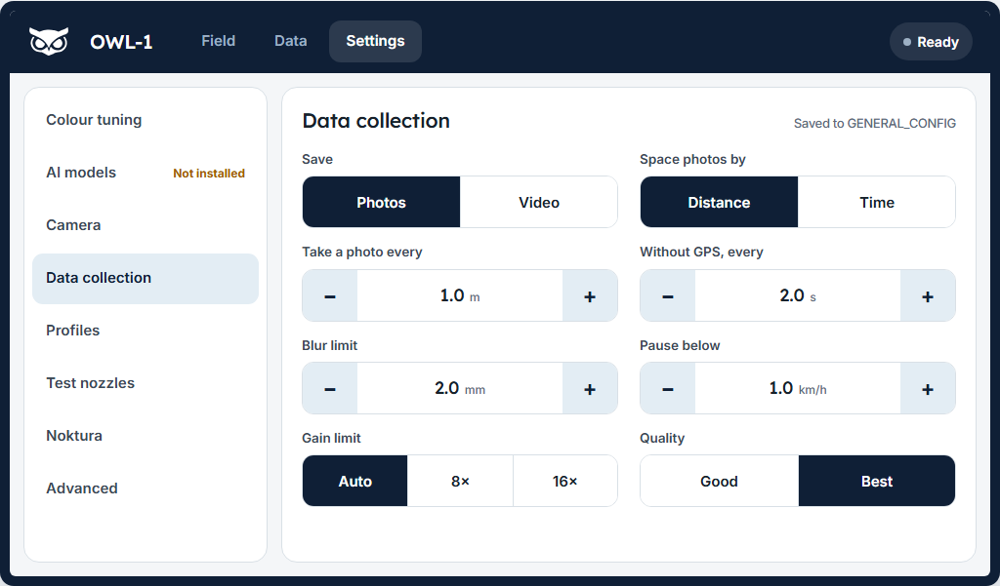

# Standalone Setup

Standalone mode turns a single OWL into a self-contained unit — it creates its own WiFi hotspot and runs its own dashboard. Connect your phone, tablet, or laptop to the OWL's WiFi to monitor and control it. No existing network or router required.

```{admonition} Haven't run the installer yet?
:class: tip

Complete the [Two-Step Install](../../software/two-step-install.md) first, then return here when prompted for dashboard setup.
```

## Example standalone controller interface

This is a live, fully interactive mock running on sample data. Open the **Video Feed** and click **Adjust geometry** to drag the crop edges and actuation band over the (mock) camera feed, or use the **Config** tab to try **Save As…** with a name and notes.

```{raw} html
<div class="owl-demo-shell owl-demo-phone">
  <iframe src="../../_static/demos/standalone/index.html"
          loading="lazy"
          title="Standalone controller interface"></iframe>
</div>
```

## The dashboard layout

The standalone dashboard uses the same design as the OWL app and the networked controller. It has three pages, chosen in the top bar: **Field**, **Data** and **Settings**. The camera fills the left of the Field page and the main controls sit on the right. Settings is a short list with a page for each topic. On a phone or a narrow screen everything stacks into one column and the three pages move to tabs at the bottom.





<a href="../../_static/demos/redesign/index.html" target="_blank" rel="noopener">Open the design preview</a> to see every screen.

## How it works

The OWL creates a WiFi hotspot (like a mobile phone sharing its connection). You connect your device to this hotspot and open the dashboard in a browser. Everything runs locally on the OWL Pi — no internet connection needed.

| Component | What it does |
|-----------|-------------|
| WiFi hotspot | Creates a network at 10.42.0.1 that your phone/laptop connects to |
| MQTT broker | Local message system for communication between detection and dashboard |
| Dashboard | Web interface with live video, detection stats, start/stop controls, and configuration |
| Nginx + SSL | Secure web server that serves the dashboard and video feed |

```{note}
For managing **multiple OWLs** from a single screen, see [Networked Setup](networked.md) instead.
```

## Run the setup

### Choose standalone mode

During the OWL installation (`bash owl_setup.sh`), the installer will ask if you want a web dashboard. Say **yes**, then select **Standalone** mode:

```{code-block} text
Do you want to add a web dashboard for remote control? (y/n): y
```

```{code-block} text
[INFO] Select OWL Operation Mode:
  1) Standalone - Create WiFi hotspot with local MQTT broker and dashboard
  2) Networked  - Connect to existing WiFi network with remote MQTT broker

Select mode (1 or 2): 1
[INFO] Standalone mode selected
```

Then configure your hotspot:

```{code-block} text
Enter OWL ID number (default: 1): 1
[INFO] Configuring WiFi Hotspot (Standalone Mode)
Enter WiFi hotspot name/SSID (default: OWL-4B7D): OWL-4B7D
Enter WiFi hotspot password (min 8 characters): ********
Re-enter WiFi password to confirm: ********
Confirm and save this password? (y/n): y
```

| Setting | Default | Description |
|---------|---------|-------------|
| OWL ID | 1 | Unique identifier — sets the hostname to `owl-1` |
| Hotspot SSID | OWL-XXXX | WiFi network name others will see. The default is derived from the Pi's hardware serial (last 4 characters), so every unit gets a unique name — two OWLs broadcasting the same SSID cannot be told apart by the phone app |
| Hotspot Password | (none) | Minimum 8 characters |

### Review and confirm

Check the configuration summary and confirm:

```{code-block} text
[INFO] Standalone Configuration Summary:
  Mode: Standalone
  Hostname: owl-1
  WiFi Hotspot SSID: OWL-4B7D
  Hotspot IP: 10.42.0.1/24
  MQTT Broker: localhost:1883 (local)
  Dashboard: https://owl-1.local/

Allow VNC remote desktop (port 5900) through the firewall? (y/n, default: n): n
Continue with these settings? (y/n): y
```

```{warning}
**If you're connected via SSH:** The Pi will switch from your current WiFi to creating its own hotspot. Your SSH connection will drop. After setup completes and the Pi reboots, connect to the new hotspot (e.g., `OWL-4B7D`) to regain access.
```

The installation runs automatically. Watch for `[OK]` messages — if everything passes, you'll see:

```{code-block} text
[INFO] OWL Setup Summary:
[OK] System Packages
[OK] MQTT Configuration
[OK] Network Configuration
[OK] Hostname Configuration
[OK] UFW Firewall Configuration
[OK] Fan Control Permissions
[OK] Service Control Permissions
[OK] Device Settings Permissions
[OK] Nginx Configuration
[OK] SSL Certificate Generation
[OK] Avahi Service Configuration
[OK] Service Management
[OK] OWL Config Files

[COMPLETE] OWL setup completed successfully!
```

<details>
<summary>What to expect during installation (click to expand)</summary>

The script installs and configures each component in order:

```text
[INFO] Installing required system packages...
[INFO] Installing MQTT broker and clients (standalone mode)...
[OK] Installing system packages completed successfully.
[INFO] Configuring MQTT broker (standalone mode)...
[INFO] Testing MQTT configuration...
[OK] MQTT configuration syntax is valid
[INFO] Restarting MQTT service...
[OK] MQTT service is running
[INFO] Testing MQTT broker...
[OK] Mosquitto service is running
[OK] Mosquitto is listening on port 1883
[INFO] Testing local MQTT connection...
[OK] Local MQTT connection successful (attempt 1)
[OK] MQTT configuration file is correct
[OK] MQTT broker core functionality verified
[OK] MQTT broker configuration and testing completed successfully.
[INFO] Setting up WiFi hotspot: OWL-4B7D...
[OK] WiFi hotspot configuration completed successfully.
[INFO] Configuring firewall (UFW)...
[OK] UFW firewall configuration completed successfully.
[INFO] Setting hostname to owl-1...
[OK] Setting hostname completed successfully.
[INFO] Configuring sudo permissions for Pi 5 fan control...
[OK] Fan control sudo permissions completed successfully.
[INFO] Configuring sudo permissions for OWL service control...
[OK] Service control sudo permissions completed successfully.
[INFO] Configuring device settings permissions (network, passwords)...
[OK] Device settings permissions completed successfully.
[INFO] Generating SSL certificates...
[OK] SSL certificate generation completed successfully.
[INFO] Setting up Nginx web server...
[OK] Nginx configuration is valid
[OK] Nginx configuration completed successfully.
[INFO] Configuring Avahi for .local domain resolution...
[OK] Avahi service configuration completed successfully.
[INFO] Starting and enabling services...
[OK] Starting services completed successfully.
[INFO] Creating systemd service for OWL Dashboard...
[OK] OWL Dashboard service started successfully
[OK] Creating and starting dashboard service completed successfully.
[INFO] Updating OWL configuration files with network settings...
[OK] OWL config files updated.
[INFO] Performing final system validation...
[INFO] Final MQTT connectivity validation...
[OK] MQTT broker ready for OWL communication
[OK] MQTT broker ready for network clients
[INFO] Testing dashboard service...
[OK] Dashboard service is responding
```


```{note}
**Broker is local-only (v3.18+).** The standalone broker listens on `127.0.0.1:1883` only
and the firewall no longer opens port 1883. `owl.py` and the dashboard talk over loopback;
the phone app and kiosk use HTTPS. If you need MQTT from another machine, use the networked
controller: its broker listens on all interfaces (`0.0.0.0:1883`) and accepts anonymous
connections, so it is open to anything on the rig network without a login.
```

The network MQTT test (`10.42.0.1`) may show a warning during setup — this is normal because the hotspot isn't fully active yet. It resolves after the reboot.

The device-settings step (v3.11+) installs a root-owned password helper
(`/usr/local/sbin/owl-set-user-password`) and sudoers entries for `nmcli` and
`reboot`; v3.12 adds `date` and `timedatectl` so the phone app can correct
the clock on RTC-less units (`/api/time/sync` — the Pi's clock freezes while
powered off and NTP never comes on a paddock hotspot). These back the phone
app's device settings: in-place Wi-Fi changes, Pi user and hotspot password
changes, clock sync, and restart/shutdown. Re-running
`controller/shared/setup.sh` on an already-deployed OWL adds them to older
units — the script is idempotent. Units without them return
`503 Device settings permissions not installed` from those routes (the time
sync route returns 503 with a re-run-setup hint).

v3.15 adds a software-update step: `/etc/sudoers.d/96-owl-update` lets the
dashboard launch `owl_update.sh` in a transient `systemd-run` unit, and the
service-control alias gains `systemctl restart owl-dash.service` so the
dashboard can restart itself after a successful update. These back the phone
app's Maintenance card (version and update, internet via the phone's hotspot,
reset network setup, factory reset of detection settings). Without the rule,
`POST /api/settings/update/start` returns
`503 Software update permissions not installed`.

</details>

In standalone mode the script then installs the Noktura cloud helper, so the
phone app can connect this OWL to Noktura later from device settings:

```text
[OK] Noktura cloud helper installed (connect from the OWL app)
```

If that step fails, you'll see a warning instead. Setup still completes, but
the app cannot connect the OWL to Noktura until you retry:

```text
[WARN] Cloud helper not installed; the app cannot connect this OWL to Noktura.
       Retry with: sudo bash .../controller/setup/install_firstboot.sh --cloud-helper
```

It then asks whether to arm phone-app first-boot
setup. Answer `n` for a unit you are configuring yourself; answer `y` only
when preparing a unit to ship to an end user (it resets the hotspot password
to the setup default and the phone app takes over on their first boot):

```text
Arm phone-app first-boot setup (for shipping to an end user)? (y/n): n
```

When prompted, reboot the OWL:

```text
Reboot now? (y/n): y
```

```{note}
Factory provisioning: `bash owl_setup.sh --factory` runs the whole install
non-interactively for a production unit (standalone mode, hotspot `OWL-XXXX`
derived from the Pi serial, on-board nRF9151 GPS, first-boot armed). It
refuses to start unless the unit already has its hardware identity
(`sudo bash owl_identity.sh --otp`). It is for units leaving the factory:
building your own OWL, run `bash owl_setup.sh` with no options. The old
`--ship` and `--ship-gps` flags were removed in v3.19.0. `setup.sh` also accepts flags for scripted
installs: `--mode standalone --owl-id N --ssid SSID --password PSK
[--arm-firstboot] [--yes]`.

Re-using a Pi that is still armed for phone-app setup? `owl_setup.sh` and
`setup.sh` (when run by hand) first ask "Disarm it and set up by hand? [Y/n]".
Enter disarms it; `n` leaves it for the phone app. Factory runs never ask.
```

```{tip}
If you need to re-run just the network/dashboard setup later (without reinstalling everything), use:

    sudo bash ~/owl/controller/shared/setup.sh
```

```{admonition} If any steps show [FAIL]
:class: warning

The summary will show error details. Review the specific error, fix the issue, and re-run:

    sudo bash ~/owl/controller/shared/setup.sh
```

## Connect to the dashboard

After the reboot:

1. On your phone, tablet, or laptop, look for the WiFi network (e.g., `OWL-4B7D`)
2. Connect using the password you set during setup
3. Open a browser and go to `https://owl-1.local/` or `https://10.42.0.1/`

The actual address uses your OWL ID — so `owl-2` would be at `https://owl-2.local/`.

```{note}
Your browser will show a security warning because the SSL certificate is self-generated. This is normal and safe to click through — the connection is encrypted.
```

The dashboard provides live video with detection overlay, real-time statistics, start/stop controls, configuration adjustments, and wireless data downloads.

## Using the dashboard

### Field

The top bar shows the OWL's name, the profile it is running, a state pill (**Spraying**, **Recording**, **Ready**, **Stopped** or **Fault**) and the power button.

- **Live view**: the camera, with buttons to adjust the crop and spray zone, save a frame and go full screen. The stream only runs while Field is open.
- **Spraying**: the big switch. It turns navy when the OWL is spraying and says which detection it uses.
- **Recording**: tapping it opens **What are you recording?**: tap the crop (and season for winter/spring crops), weather, light and sky, soil cover, soil, recent water and purpose, add an optional note, then **Start recording**. **+ Add crop** saves a crop that is not listed on this OWL for next time (`custom_crops` in `[Collect]`). **Pause** stops saving at a headland turn and **Resume** carries on in the same session. Your last choices are pre-selected. These labels go into every image and the session's `session_metadata.json`, which Noktura reads when the session is uploaded. While recording, the switch shows the photo count and the chosen labels, or **Paused below X km/h** when the tractor is too slow for still images.
- **Detect with**: Colour, AI, Hybrid or Painted. AI and Hybrid carry an amber dot when this OWL can't run them (AI not installed, or no model yet). Tapping one then explains why and links to **Settings > AI models**; detection stays on colour.
- **Sensitivity**: Low, Medium or High (custom presets appear next to them). It drives whichever detection is selected.
- **Stat cells**: status, CPU temperature, free storage and GPS speed.

Faults, a refused recording, a speed warning or a needed restart show as notices above **Detect with**.

The **power button** offers **Shut down**, **Restart** and **Stop detection** (or **Start detection**). Shut down and Restart ask to confirm. On an OWL that was set up with the OWL app, the first time you do this from a browser it asks once for the OWL's hotspot password.

### Settings

| Page | What it holds |
|------|---------------|
| Colour tuning | Green, hue, saturation, brightness and smallest-weed sliders; painted profiles (Paint weeds, Edit, Delete) in Painted mode |
| AI models | What runs the AI (Hailo-8, CPU only, or not installed with **Install AI**), the models on this OWL, which classes to spray, tracking, AI confidence and crop buffer |
| Camera | White balance (Auto, Sun, Locked by calibration), brightness, crop and spray zone, picture size and rotation (these two restart the OWL program) |
| Data collection | The capture settings described below, and tagging photos with the screen's location |
| Profiles | The running profile, switch profile, save as a new profile, reload, reset to default |
| Test nozzles | **Hold to spray** (every nozzle while you hold, stops after 10 s) and **Blanket spray**, plus the spray timing readout |
| Noktura | The cloud link status, the Noktura address and a QR code |
| Maintenance | Software update, fan (Auto or full speed), the cab switch setting for a UTE controller, messages, restart detection, download logs, USB drives and the file browser, reset network setup |
| Advanced | The full INI editor and the AI assistant |

On a phone, Settings is a list; tap a row to open its page and **Settings** at the top to go back.

### Using a wired controller

If you have a [wired controller](../wired/index.md) (UTE or Advanced) connected, the dashboard only locks the controls that the hardware switch manages. Everything else stays interactive:

| Controller | What the hardware controls | What you can still use on the dashboard |
|------------|--------------------------|----------------------------------------|
| UTE | Recording (or spraying, set under Maintenance) | Detection, tracking, nozzles, sensitivity, fan |
| Advanced | Recording, detection, sensitivity | Tracking, nozzles, fan |

Locked switches are dimmed. Use the physical switch to change them.

### GPS and image tagging

If you open the dashboard on a phone with GPS enabled, captured images can be tagged with your location. This is useful for mapping weed hotspots: you can plot geotagged images on a map later.

To use GPS:

1. Open the dashboard on your phone (GPS must be allowed in the browser)
2. Go to **Settings > Data collection** and set **Tag photos with this screen's location** to **On**. The accuracy shows next to it
3. While GPS is active, every saved image includes location coordinates

```{tip}
GPS tagging relies on your phone's browser sending location updates. If you close the browser, switch to another app, or lose signal, tagging stops within a few seconds. Reopen the dashboard to resume.
```

If you have a wired controller connected, a GPS status LED on the controller box shows the current state:

| LED pattern | Meaning |
|-------------|---------|
| Solid on | GPS lock: images are being tagged |
| Regular flashing | Acquiring: waiting for signal |
| Double flash, pause | Error or stale: phone disconnected or no signal |
| Off | GPS not active |

### Data collection settings

**Settings > Data collection** holds the same settings as the in-cab controller's collect screen:

- **Record as**: still images or video clips (5 to 60 s)
- **Take images**: every Nth frame (the OWL default), by distance (every X metres from GPS speed, every Y seconds without GPS, nothing while parked) or by time
- **Pause below**, **Image quality**, **Blur limit**, **Limit shutter time for speed** and **Gain limit**, with - and + buttons

Changes apply straight away, without a restart, and are saved to the active config's `[DataCollection]` section (`[Camera] max_gain` for the gain limit). The record form's preset lists and language come from `[Collect]` in `CONTROLLER.ini`; see [Configuration](../../software/configuration/index.md).

### Tuning detection and geometry

**Settings > Colour tuning** applies slider changes straight away. To keep them, open **Settings > Profiles** and tap **Save as new profile**: a dialog asks for a **name** and optional **notes**, and whether to **Make active on reboot**. If the active profile is a custom one, the dialog also offers **Update "&lt;name&gt;"** to overwrite it in place. The profile list switches the active boot config, and the top bar shows what's running. **Settings > Advanced** edits the full configuration file.

To set the crop and actuation band visually, tap the crop button on the Field live view (or **Settings > Camera > Adjust on the live view**). The editor switches the preview to the full uncropped frame while open (and back afterwards), so the overlay lines up without touching detection:

- Drag the four **edge handles** to crop independently from each side (exclude a boom, wheel track, or shaded edge). Relay **lane lines** redraw live and recenter across the cropped width.
- Drag the two **band handles** to set the **actuation band**: a weed fires only while its centre is inside it. Raise the top to ignore weeds too far ahead; lower the bottom to ignore weeds too close.
- Use the **nudge buttons** in the right column for fine adjustment. **Done** saves the geometry to `GEOMETRY.ini`; **Cancel** reverts to how it was when you opened the editor.

Geometry lives in its own `GEOMETRY.ini` (separate from named detection configs) and maps to the `crop_left/right/top/bottom` and `actuation_top/bottom` keys, which can also be set by hand; see [Configuration](../../software/configuration/index.md).

## Downloading recorded images

```{important}
You need a USB drive plugged into the OWL to record images. See [USB drive requirements](../wired/index.md) for recommended drives.
```

When recording is enabled, the OWL saves images to the USB drive in date-based folders (e.g., `20260315/`). You can download these wirelessly without unplugging the drive.

### The Data page

The **Data** page lists each recording with its date, photo count and size, and the crop and conditions it was recorded with. Each recording has **Download** (a ZIP of the session), **Details** (add or correct the crop and conditions of a run recorded without them) and a delete button. A storage card shows the free space.

### The downloads page

For previews of single images, open `https://owl-1.local/downloads` in your browser, or tap **All files and previews** on the Data page.

The page lists each recording session by date, with image count and total size. From here you can:

- **Preview images** — tap a session to expand a thumbnail grid. Tap any thumbnail to see the full image
- **Download as ZIP** — downloads all images from that session as a single file
- **Delete a session** — permanently removes the images from the USB drive

A storage bar at the bottom shows how full the USB drive is.

```{warning}
Deleting a session permanently removes the images from the USB drive. There is no undo. Download the data first if you need it.
```

## Troubleshooting

### Hotspot or dashboard not working

```bash
# Check if the hotspot is active
nmcli con show --active

# If the hotspot isn't listed, start it manually
sudo nmcli con up "OWL-4B7D"

# Check all services are running
sudo systemctl status owl-dash nginx mosquitto

# Restart everything
sudo systemctl restart NetworkManager
sudo systemctl restart owl-dash nginx mosquitto

# View dashboard logs
journalctl -u owl-dash -f
```

### OWL service or camera problems

```bash
# Check the detection service
sudo systemctl status owl.service
journalctl -u owl.service -f

# Test the camera
rpicam-hello --list-cameras

# If "No cameras available":
# 1. Check the ribbon cable connection
# 2. Enable camera in raspi-config:
sudo raspi-config
# Interface Options > Camera > Enable
```

For more help, see the [full Troubleshooting Guide](../../troubleshooting/index.md).

## Reference

### Configuration files

The setup script writes these automatically — you should not need to edit them manually.

| File | Location | Purpose |
|------|----------|---------|
| `GENERAL_CONFIG.ini` | `~/owl/config/` | Detection parameters, sensitivity presets, relay mapping |
| `CONTROLLER.ini` | `~/owl/config/` | MQTT settings, network mode, dashboard port |
| Network config summary | `/opt/owl-dash-config.txt` | Human-readable record of your setup choices |

### System services

| Service | Purpose |
|---------|---------|
| `owl.service` | Weed detection and camera |
| `owl-dash` | Dashboard web application |
| `mosquitto` | MQTT message broker |
| `nginx` | Web server (SSL, video proxy) |

Common commands:

```bash
# Check status
sudo systemctl status owl.service owl-dash mosquitto

# Restart detection or dashboard
sudo systemctl restart owl.service
sudo systemctl restart owl-dash

# View live logs
journalctl -u owl.service -f
journalctl -u owl-dash -f
```

### MQTT topics

In standalone mode, topics use a simple structure (no device ID prefix):

| Topic | Purpose |
|-------|---------|
| `owl/state` | Full device state (detection mode, algorithm, settings) |
| `owl/commands` | Control commands (start, stop, config changes) |
| `owl/status` | Heartbeat and connectivity |
| `owl/detection` | Weed detection events |
| `owl/cloud_commands` | Commands from Noktura through the cloud bridge (only when connected). Only an allowlist is acted on, never full control |
| `cloud_out/state` | Small status for Noktura, sent when something the cloud uses changes or every 20 s. This is what the cloud bridge sends (under 0.5 MB per running hour), not the full state. OWLs connected before v3.21.0 need **Connect** again from the app, after `sudo bash ~/owl/controller/setup/install_firstboot.sh --cloud-helper` |

To test MQTT:

```bash
# Subscribe to all OWL messages
mosquitto_sub -h localhost -t "owl/#" -v

# Send a test message
mosquitto_pub -h localhost -t "owl/test" -m "hello"
```

## Next steps

```{seealso}
- [Networked Setup](networked.md) - Connect multiple OWLs to a shared network
- [Configuration Guide](../../software/configuration/index.md) - Fine-tune detection parameters
- [Operation Guide](../../usage/operation/index.md) - Understand detection algorithms
- [Use Cases](../../usage/use-cases/index.md) - Mounting and application examples
- [Controllers](../../controllers/index.md) - Wired and wireless controller options
```
